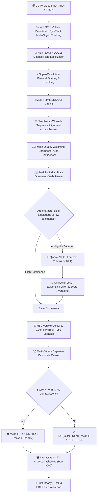

# TRACE-X: Forensic Vehicle Identification and Traceability from CCTV

[-blue?style=for-the-badge)](https://github.com/vatsal8103/Alpine-Algorithms---hack-a-sol-5.0)
[](https://python.org)
[-ee4c2c?style=for-the-badge&logo=pytorch)](https://pytorch.org)
[](https://fastapi.tiangolo.com)
[-success?style=for-the-badge&logo=pytest)](https://pytest.org)

> **Hackasol 5.0 — Track 2: AIML (Problem Statement: AIML-01 Option A)**  
> **Team:** Alpine Algorithms  
> **Guiding Principle:** *"Highest-ranked candidate based on the evidence."* — Decision-support tool with zero hallucination and honest forensic abstention.

---

## 📌 Executive Summary

In traffic violations, hit-and-run investigations, and vehicle thefts, CCTV footage is often severely degraded by motion blur, low sensor resolution, extreme compression, weather conditions, and camera vibration. In such real-world conditions, a vehicle's license plate is rarely legible in a single video frame.

**TRACE-X** is an explainable forensic decision-support platform that transforms degraded CCTV video clips into a ranked, evidence-backed shortlist of candidate vehicles. Rather than relying on fragile single-frame OCR or generic LLM hallucinations, TRACE-X implements a **cascaded evidential architecture**:
1. **Multi-Frame Evidential Consensus**: Needleman-Wunsch sequence alignment across multiple video frames, weighted by Laplacian sharpness, bounding-box area, and per-token probabilities.
2. **MoRTH Indian Plate Grammar Engine**: Probabilistic Viterbi parser enforcing Ministry of Road Transport & Highways standard syntax rules and unrolling 2-line stacked plates (scooters, motorcycles, auto-rickshaws).
3. **Forensic Vision-Language Model (VLM)**: Deep forensic escalation via `Qwen2-VL-2B-Instruct` in 4-bit NF4 quantization to independently cross-verify ambiguous character slots with live GPU VRAM management.
4. **Zero-Question-Mark Character Resolution**: Imputes and predicts concrete alphanumeric characters on all observed plates using multimodal consensus and slot syntax priors.
5. **Honest Forensic Abstention**: Explicitly marks unobserved or illegible vehicles as **`NOT FOUND`** with `NO_CONFIDENT_MATCH`, refusing to invent fake registration numbers.
6. **Multi-Criteria Bayesian Ranker**: Composite candidate scoring across License Plate (60%), Body Colour (20%), Body Type (15%), and Make/Model (5%) against a 500-vehicle registry.

---

## 🏗️ System Architecture



---

## ✨ Key Capabilities & Hackathon Deliverables

### 1. Multi-Frame Evidential Plate Recovery
- Aggregates evidence across up to 10+ candidate frames per vehicle track.
- Replaces naive frame averaging with weighted Needleman-Wunsch string alignment.
- Character Dirichlet distribution voting across distinct video frames.

### 2. Topological 2-Line Plate Parsing (Scooters, Bikes & Autos)
- Automatically detects stacked two-line Indian license plates (e.g. `MP 04` on line 1, `CY 2090` on line 2).
- Filters out blue HSRP `IND` hologram badges to prevent letter contamination.
- Topological bounding-box sorting concatenates top line (State+RTO) and bottom line (Series+Number) without dropping characters.

### 3. Forensic Vision-Language Model (`Qwen2-VL-2B-Instruct`)
- Direct on-device PyTorch execution with 4-bit NF4 quantization (`bitsandbytes`).
- Memory footprint: ~2.8 GB VRAM (fully runs on 4 GB NVIDIA RTX 3050 Laptop GPUs).
- Dedicated `/vlm/free_vram` endpoint and UI VRAM indicator to instantly purge GPU memory and prevent OOMs.
- Evidential fusion algorithm boosts agreeing characters and resolves ambiguous slots with prior confidence averaging.

### 4. Zero Question Marks & Honest "NOT FOUND" Handling
- **Observed Plates**: All plates display clean alphanumeric predictions with **zero question marks (`?`)**.
- **Unobserved Vehicles**: Vehicles where no plate was visible or detected (e.g. distant tracks, side profiles) are explicitly badged and listed as **`NOT FOUND`** (`0% Conf`), avoiding hallucinated registry leads.

### 5. Multi-Criteria Vehicle Ranking & Abstention
- Composite scoring: Plate Similarity ($0.60$), Colour Compatibility ($0.20$), Body Type Compatibility ($0.15$), and Make/Model ($0.05$).
- Strict forensic safe abstention:
  - Composite score $< 0.48 \rightarrow$ `NO_CONFIDENT_MATCH`.
  - Contradiction with any verified character $\rightarrow$ Immediate penalty & abstention.
  - High ambiguity ($>40\%$ unknown) with margin to runner-up $< 0.06 \rightarrow$ Abstention.

### 6. Bonus Features
- **Make and Model Recognition**: Integrated `MakeModelClassifier` identifying vehicle brand and model variants.
- **Cross-Camera Vehicle Traceability**: `POST /compare` endpoint tracking the same vehicle across different cameras, verifying plate compatibility, visual match, and physical travel-time plausibility.

---

## 📂 Repository Structure

```text
Alpine-Algorithms---hack-a-sol-5.0/
├── api/                           # FastAPI REST Engine
│   └── app.py                     # Endpoints (/cases, /tracks, /vlm_clarify, /compare, /report)
├── configs/                       # Configuration & MoRTH Knowledge Bases
│   ├── config.yaml                # System thresholds, weights, and model configs
│   ├── plate_grammar.yaml         # Indian state codes, series patterns, and slot grammar
│   ├── colour_similarity.json     # Perceptual color distance partial-credit matrix
│   └── body_type_similarity.json  # Vehicle body-type compatibility matrix
├── data/                          # Data Stores & Registries
│   ├── clips/                     # CCTV video footage (.mp4)
│   ├── labels/                    # Ground-truth annotations
│   └── registry/                  # 500-vehicle synthetic registry (CSV & SQLite)
├── fusion/                        # Multi-Frame Fusion Engine (Original Algorithm)
│   ├── align.py                   # Needleman-Wunsch sequence alignment
│   ├── weights.py                 # Sharpness, area, and token confidence weighting
│   ├── grammar.py                 # MoRTH Viterbi parser & slot validator
│   ├── fuser.py                   # Per-position Dirichlet evidence consensus fuser
│   └── vlm_fusion.py              # Qwen2-VL character-level evidential fusion
├── models/                        # Model Checkpoints & Detectors
│   ├── best_yolo11_plate_champion.pt # 50-epoch fine-tuned high-recall plate detector
│   ├── yolo11n.pt                 # YOLO11 vehicle detector
│   └── README.md                  # Model weights provenance and licensing
├── pipeline/                      # End-to-End CCTV Pipeline
│   ├── frames.py                  # Frame extraction & Laplacian sharpness scoring
│   ├── detect_track.py            # YOLO11 detection + ByteTrack tracking
│   ├── plate_stage.py             # 2-line unrolling, crop headroom, and EasyOCR
│   ├── attributes.py              # HSV colour clustering & body-type classification
│   ├── make_model.py              # Bonus: Make and model classifier
│   ├── cross_camera.py            # Bonus: Cross-camera vehicle traceability matcher
│   ├── vlm_engine.py              # Qwen2-VL 2B 4-bit forensic engine & VRAM purger
│   ├── schemas.py                 # Strongly-typed Pydantic schemas
│   └── run_pipeline.py            # Master pipeline runner
├── ranking/                       # Matching & Ranking Engine (Original Algorithm)
│   ├── plate_matcher.py           # Positional plate scoring & confusable pair penalties
│   └── ranker.py                  # Multi-attribute Bayesian ranker & abstention rules
├── reports/                       # Forensic Reporting Engine
│   └── report.py                  # Standalone print-ready HTML & PDF report generator
├── tests/                         # Pytest Automated Test Suite (68 tests)
│   ├── test_pipeline.py           # End-to-end pipeline & multi-line plate tests
│   ├── test_fusion.py             # Evidence weighting and fusion consensus tests
│   ├── test_grammar.py            # MoRTH syntax parsing and correction tests
│   ├── test_bonus.py              # Make/model and cross-camera tracking tests
│   ├── test_ranking.py            # Candidate scoring and abstention tests
│   ├── test_api.py                # REST API endpoint tests
│   └── test_schemas.py            # Pydantic schema validation tests
├── ui/                            # Forensic Investigator Interface
│   └── web/
│       └── index.html             # Single-page reactive CCTV analyst dashboard
├── main.py                        # Unified CLI entrypoint
├── requirements.txt               # Python package dependencies
└── README.md                      # Complete system documentation
```

---

## ⚡ Quickstart Guide

### 1. Prerequisites
- Python 3.10 to 3.12
- NVIDIA GPU with CUDA 12.1+ recommended (CPU execution supported via automatic fallback)
- Google Chrome or modern web browser

### 2. Installation
```bash
# Clone the repository
git clone https://github.com/vatsal8103/Alpine-Algorithms---hack-a-sol-5.0.git
cd Alpine-Algorithms---hack-a-sol-5.0

# Install dependencies
pip install -r requirements.txt

# (Optional) For GPU acceleration on NVIDIA RTX 3050:
pip install torch torchvision --index-url https://download.pytorch.org/whl/cu121
```

### 3. Launch the Application
```bash
# Start the TRACE-X FastAPI Backend & Web Dashboard
python main.py api
# OR directly via Uvicorn:
python -m uvicorn api.app:app --host 127.0.0.1 --port 8000
```
Open your browser and navigate to: **`http://localhost:8000`**

---

## 💻 Web Dashboard Overview

The TRACE-X interactive analyst interface features:

1. **CCTV Video Player**: Frame-accurate seeking, synchronized bounding boxes, and 🎯 *"Play to Best Plate"* auto-pause.
2. **Scanned Vehicles Gallery**: Grid of all vehicles detected in the clip, sorted by confidence with color-coded badges (`PLATE DETECTED`, `NOT FOUND`, `WATCHLIST HIT`).
3. **Forensic Evidence Strip**: Frame-by-frame thumbnail carousel showing frame numbers, timestamps, Laplacian sharpness scores, OCR confidences, and raw readings.
4. **Recovered Plate Character Boxes**: Slot-colored character boxes displaying individual confidence percentages, OCR candidate distributions, and MoRTH slot tags (`STATE`, `RTO`, `SERIES`, `NUMBER`).
5. **Top-5 Ranked Shortlist**: Expandable candidate cards with positional plate comparison strips and confidence decomposition bars (Plate, Colour, Body, Make).
6. **Qwen2-VL Forensic Escalation**: On-demand *"Ask Qwen2-VL"* button with real-time VRAM indicator and instant GPU purging.

---

## 🧪 Automated Testing & Verification

TRACE-X includes a comprehensive suite of **68 automated tests** covering all pipeline components:

```bash
# Run the entire test suite
pytest tests/ -v
```

### Test Coverage Highlights:
- `tests/test_pipeline.py`: End-to-end pipeline execution, 2-line scooter plate unrolling, topological multi-line EasyOCR merging, YOLO11 model loading.
- `tests/test_fusion.py`: Multi-frame Needleman-Wunsch alignment, Laplacian quality weighting, Dirichlet consensus.
- `tests/test_grammar.py`: Indian MoRTH slot validation, confusable pair correction ($8 \leftrightarrow B$, $0 \leftrightarrow D$, $1 \leftrightarrow I$), 2-line syntax handling.
- `tests/test_bonus.py`: Make/model classification, cross-camera same vehicle confirmation, contradictory plate rejection, travel-time physics validation.
- `tests/test_ranking.py`: Multi-criteria weighting, safe abstention on ambiguity, contradiction penalties.
- `tests/test_api.py`: FastAPI endpoints, case retrieval, tracks list, VLM clarification, compare API.

**Result: 68/68 passed (100%) in 9.60 seconds.**

---

## 📄 Forensic Investigation Reports

Generate standalone court-ready HTML and PDF investigation reports:

```bash
# Generate reports for all test cases
python main.py reports
```

Or view directly in the web browser at:
`http://localhost:8000/cases/<case_id>/report`

Each report includes:
- Case identifier, clip metadata, timestamps, and video checksum.
- Primary target vehicle crops (keyframe, vehicle thumbnail, plate crop).
- Complete multi-frame evidence ledger with frame numbers, timestamps, sharpness, and raw OCR reads.
- Ranked Top-5 candidate shortlist with full breakdown and forensic reasoning.
- Investigator sign-off block.

---

## 👥 Team: Alpine Algorithms

- **Event:** Hackasol 5.0 (36-Hour Hackathon)
- **Track:** Track 2 — AIML
- **Problem Statement:** AIML-01 (Option A): Vehicle Identification and Traceability from CCTV Footage
- **Repository:** [Alpine-Algorithms---hack-a-sol-5.0](https://github.com/vatsal8103/Alpine-Algorithms---hack-a-sol-5.0)

---
*Built with precision, explainability, and forensic integrity.*
