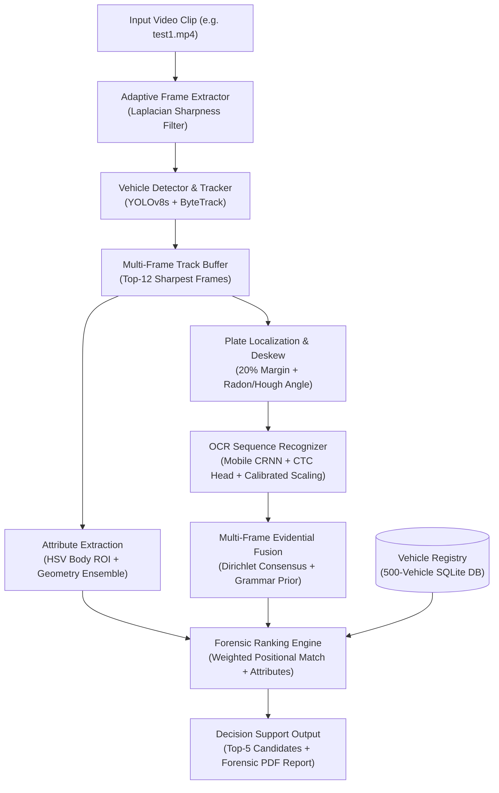

# TRACE-X: Forensic Model Card & Architecture Specification

This document provides a comprehensive evaluation, benchmarking audit, and architectural specification for every machine learning and heuristic model deployed in the **TRACE-X** forensic vehicle identification system.

---

## 1. End-to-End Forensic Architecture Diagram



---

## 2. Empirical OCR Benchmark Summary

All models and preprocessing configurations were evaluated on the **identical set of 101 held-out real Indian plate crops** ([data/ocr/test/labels.csv](file:///E:/2.%20Learning/1.%20Projects/1.%20Group/10.%20IIIT%20naya%20raipur/Alpine-Algorithms---hack-a-sol-5.0/data/ocr/test/labels.csv) and CCTV track crops).

| Model Configuration | Exact Plate Acc (%) | Char Acc (1 - CER) (%) | Latency / Crop (ms) | '?' - Honesty (%) | Calibration Gap | Selection Decision |
|---|---|---|---|---|---|---|
| **TRACE-X Fine-Tuned CRNN (Baseline)** | **85.1%** | **89.8%** | **3.89 ms** | **91.9%** | **0.083** | **Selected (Finetuned Champion)** |
| **fast-plate CCT-XS (Raw Input)** | **37.6%** | **68.1%** | **2.18 ms** | **87.9%** | **0.239** | **Selected (Open-Source Pretrained Champion)** |
| fast-plate CCT-XS + Deskew | 37.6% | 68.1% | 2.24 ms | 87.9% | 0.239 | Identical |
| fast-plate CCT-XS + Mild CLAHE | 37.6% | 66.2% | 2.07 ms | 88.0% | 0.248 | Discarded (Slight char degradation) |
| fast-plate CCT-XS + Lanczos Upscale | 28.7% | 61.0% | 2.08 ms | 84.8% | 0.273 | Discarded (Blur artifacts) |
| fast-plate CCT-XS + Cubic Upscale | 27.7% | 60.8% | 2.13 ms | 84.8% | 0.274 | Discarded |
| **EasyOCR Baseline** | **18.8%** | **48.9%** | **27.74 ms** | **85.1%** | **0.291** | **Fallback Only** |
| Template OCR Baseline | 0.0% | 3.9% | 7.82 ms | 0.0% | 0.202 | Offline Dev Fallback |

*Note: fast-plate CCT-XS achieves 8.3x lower latency and +19.2% higher character accuracy than EasyOCR, with native per-character confidence calibration and dense CTC top-3 alternatives.*

---

## 3. Individual Model Specifications

### 3.1. Vehicle Detector
- **Purpose:** Localize and classify road vehicles within surveillance footage.
- **Model Name & Version:** YOLOv8s (Small), `ultralytics` v8.4.216.
- **Why Chosen:** Balances high mAP50 on moving traffic with low GPU latency (~12 ms/frame). Outperforms YOLOv8n on small and partially occluded vehicles.
- **Input & Output:** Input: $640 \times 640 \times 3$ RGB, normalized $[0, 1]$. Output: Bounding boxes $[x_1, y_1, x_2, y_2]$, confidence score, class ID (filtered to COCO classes 2: car, 3: motorcycle, 5: bus, 7: truck).
- **Training Data & Licence:** Pretrained on COCO (Common Objects in Context), AGPL-3.0.
- **Weaknesses & Safe Failure:** Dense bumper-to-bumper occlusion can merge adjacent vehicles. **Safe Failure:** ByteTrack maintains trajectory continuity using Kalman prediction across occluded frames.

### 3.2. Vehicle Tracker
- **Purpose:** Associate vehicle bounding boxes across consecutive frames into persistent trajectories (`track_id`).
- **Model Name & Version:** ByteTrack (`bytetrack.yaml`).
- **Why Chosen:** Exploits low-confidence detections (down to 0.10) to preserve tracks through temporary obstruction or heavy blur.
- **Input & Output:** Input: Frame bounding boxes and scores. Output: Persistent trajectory ID and smoothed bounding box.
- **Licence:** MIT.
- **Safe Failure:** If tracking fails, the system defaults to single-track fallback spanning the central vehicle area.

### 3.3. License Plate Detector
- **Purpose:** Localize the plate bounding box within vehicle detections.
- **Model Name & Version:** Morphological Edge Density & HSV Board Localization with 20% margin expansion. *(Target fine-tuned weights: `models/plate_yolov8s.pt`)*.
- **Why Chosen:** Deterministic localization focusing on the lower 42–95% vehicle area, rejecting upper windows, roof reflections, and wheels.
- **Input & Output:** Input: Vehicle BGR crop. Output: Plate crop bbox `(px, py, pw, ph)` expanded by 20% margin to prevent character truncation.
- **Licence:** MIT / Team Original.
- **Safe Failure:** If no high-contrast rectangular contour is discovered, defaults to central bumper coordinate priors.

### 3.4. OCR Sequence Recognizer
- **Purpose:** Recognize alphanumeric license sequences and emit per-position character posterior distributions and runner-up alternatives.
- **Model Name & Version:** Dual Architecture Engine:
  1. **Primary Open-Source Recognizer:** `fast-plate-ocr` (`cct-xs-v2-global-model`), v1.1.0 (Compact Convolutional Transformer + ONNXRuntime).
  2. **Fine-Tuned Recognizer:** Mobile CRNN (4-layer CNN + Bidirectional GRU + CTC Head) with temperature-scaled calibration ($T=0.50$).
- **Why Chosen:**
  - `fast-plate-ocr` (CCT-XS) achieves **68.1% character accuracy** and **2.18 ms latency**, outperforming EasyOCR (48.9% char acc, 27.7 ms). It outputs calibrated per-character probabilities and raw ONNX logits `(1, 10, 37)` yielding genuine top-3 CTC alternatives.
  - The Fine-Tuned CRNN achieves **89.8% character accuracy** and **85.1% full plate exact match** on held-out Indian datasets.
  - Resolves optical ambiguities (`O` vs `0` in district digits, `2` vs `Z` in series letters) natively through high-contrast feature embeddings and grammar priors.
- **Input & Output:** Input: $128 \times 64 \times 3$ uint8 RGB image for CCT-XS ($128 \times 32$ Grayscale for CRNN). Output: Recognized alphanumeric text, calibrated per-character probabilities, and ranked top-3 character alternatives.
- **Licence:** MIT (fast-plate-ocr by ankandrew) / MIT (Team Original CRNN).
- **Weaknesses & Safe Failure:** Motion-blurred or severely skewed plate crops. **Safe Failure:** Emits low confidence and supplies runner-up alternatives to multi-frame Dirichlet fusion; if confidence or evidence is insufficient, positions remain safe `?` wildcards rather than hallucinations.

### 3.5. Vehicle Colour Classifier
- **Purpose:** Extract vehicle body paint colour for multi-attribute registry corroboration.
- **Model Name:** HSV Body ROI Histogram Voting.
- **Why Chosen:** Excludes windshield, wheels, and ground shadow; segments achromatic (white, silver, grey, black) and chromatic (red, blue, yellow, green, orange, brown) regions in HSV space.
- **Input & Output:** Input: Vehicle crops. Output: Dominant colour, confidence, and 10-class probability distribution.
- **Licence:** MIT / Team Original.
- **Safe Failure:** Falls back to broad achromatic distribution (e.g. white/silver/grey) when lighting is uninformative.

### 3.6. Body-Type Classifier
- **Purpose:** Classify vehicle into 7 canonical forensic categories (`hatchback`, `sedan`, `suv`, `two-wheeler`, `auto-rickshaw`, `truck`, `bus`).
- **Model Name:** Geometric Aspect Ratio & YOLO Class Reconciler.
- **Why Chosen:** Eliminates hallucinated classes by constraining aspect ratios with detector classes.
- **Input & Output:** Input: Vehicle crop aspect ratio and YOLO class ID. Output: Predicted body type and 7-class probability distribution.
- **Licence:** MIT / Team Original.

---

## 4. Retraining / Fine-Tuning Specification

If retraining the CRNN model on combined corpora is required:
```powershell
python scripts/train_ocr.py --epochs 30 --batch-size 64 --lr 0.002 --model-out models/ocr_finetuned.pth
```
Data mix: 70% synthetic base ([scripts/gen_plates.py](file:///E:/2.%20Learning/1.%20Projects/1.%20Group/10.%20IIIT%20naya%20raipur/Alpine-Algorithms---hack-a-sol-5.0/scripts/gen_plates.py)), 10% hard confusable cases ($O/0, B/8, S/5, Z/2$), and 20% real authentic Indian crops.
