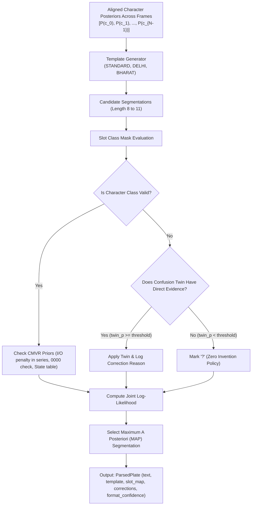

# TRACE-X Indian License Plate Grammar Module

## Executive Summary for Judges
Forensic vehicle identification in Indian surveillance footage faces severe real-world challenges: degraded CCTV resolution, harsh sunlight glares, oblique angles, and font similarities that cause optical character recognition (OCR) confusion twins (e.g., `O`/`0`, `B`/`8`, `I`/`1`, `S`/`5`, `Z`/`2`).

Naive systems rely on hardcoded regular expressions that crash on real-world Indian plate variants or blindly swap characters without evidence. The **TRACE-X Plate Grammar Module** is a **probabilistic dynamic programming (Viterbi) decoder** that enforces the legal structure of Indian vehicle registration plates mandated by the Central Motor Vehicles Rules (CMVR) 1989 and subsequent Ministry of Road Transport and Highways (MoRTH) Gazette notifications.

> [!IMPORTANT]
> **Cardinal Forensic Principle:**
> The grammar engine **only CONSTRAINS and EXPLAINS** reads. It **strictly NEVER invents a character** that the multi-frame OCR evidence does not support. If a slot rule cannot be resolved with verified evidence, the position is marked `?` (Safe Abstention).

---

## 1. Verified Rule & Template Table

All grammar rules and templates are centralized in `configs/plate_grammar.yaml` as the **Single Source of Truth** across the pipeline, fusion engine, ranker, and synthetic generators.

| Template ID | Target Vehicle Class | Positional Slot Segmentation | Slot Class Mask | Legal Constraints & CMVR Rules | Canonical Example |
| :--- | :--- | :--- | :--- | :--- | :--- |
| **`STANDARD`** | Civilian Private & Commercial Vehicles | `[state: 2L]` `[rto: 1-2D]` `[series: 1-3L]` `[number: 4D]` | Letters: `A-Z` Digits: `0-9` | • State must match 36 active / 5 legacy codes. • Letters `I` and `O` omitted from series (CMVR Rule 51(8)). • Serial `0000` is strictly illegal. • 1-digit RTO allowed without leading zero. | `MH12AB1234` `KA03MN4821` `CG04TR7788` `JH05AB6799` |
| **`DELHI`** | Delhi NCT Category-Coded Plates | `[state: 2L]` `[rto: 1-2D]` `[delhi_class: 1L]` `[series: 1-2L]` `[number: 4D]` | Letters: `A-Z` Category: `C,S,P,R,T,V,Y,E` Digits: `0-9` | • State prefix strictly `DL`. • Category letters: `C` (Car), `S` (Two-wheeler), `P` (Bus), `R` (Auto-rickshaw), `T` (Taxi), `V` (Van), `Y` (Private Hire), `E` (EV). | `DL8CAF1234` `DL1CS1234` |
| **`BHARAT`** | Bharat (BH) National Mobility Plates | `[bh_year: 2D]` `[bh_tag: 2L]` `[number: 4D]` `[series: 1-2L]` | Year: `21-29` Tag: strictly `BH` Digits: `0-9` Series: `A-Z` | • MoRTH Notification G.S.R. 594(E) / CMVR Rule 50(8). • Pos 0-1 must be valid 2-digit year (e.g. 21 to 29). • Pos 2-3 strictly national tag `BH`. • Serial `0001` to `9999`. Series excludes `I` and `O`. | `22BH1234AA` `24BH9999B` |
| **`UNRECOGNISED_FORMAT`** | Military, Diplomatic, Temporary, Trade | Retained as raw token with special format flags | Specialized symbol sets (`↑`, `CD`, `CC`, `UN`, `TC`, `T`) | • Never forced into civilian templates. • Flagged as `special_military_format` or `special_diplomatic_format`. | `↑22B137541M` `11CD01` |

---

## 2. Legal Authorities & Citations

1. **Central Motor Vehicles Rules (CMVR) 1989 (Rules 50, 51, 80, 81):**
   - *Authority:* Ministry of Road Transport and Highways (MoRTH), Government of India.
   - *URL:* [https://parivahan.gov.in/](https://parivahan.gov.in/) / [https://morth.nic.in/central-motor-vehicles-rules-1989](https://morth.nic.in/central-motor-vehicles-rules-1989)
   - *Rule 51(8):* Mandates that alphabetical series letters strictly omit `I` and `O` to prevent visual collision with digits `1` and `0`.
2. **MoRTH Gazette Notification S.O. 1332(E) (12 March 2024):**
   - *Authority:* The Gazette of India / Government of Telangana.
   - *Scope:* Formal amendment of the state registration code for Telangana from `TS` to `TG`. Older registrations under `TS` remain grandfathered (`legacy` status).
3. **MoRTH Gazette Notification G.S.R. 594(E) (26 August 2021) - Bharat (BH) Series:**
   - *Authority:* MoRTH, Government of India.
   - *Scope:* Introduced CMVR Rule 50(8) governing the format `YY BH #### XX` for national mobility.
4. **Transport Department, Government of NCT of Delhi:**
   - *Authority:* Government of National Capital Territory of Delhi.
   - *Scope:* Codified vehicle classification letters embedded between RTO district numbers and the series block.

---

## 3. Positional Viterbi Decoder Architecture

### Dynamic Programming Formulation
For a plate observation of length $N$, the parser evaluates candidate templates $T \in \{\text{STANDARD}, \text{DELHI}, \text{BHARAT}\}$. Each template defines a sequence of slots $S = (s_1, s_2, \dots, s_K)$ with length bounds $[\min_k, \max_k]$ such that $\sum_{k=1}^K |s_k| = N$.

The joint score for segmentation $\sigma$ is:
$$\mathcal{S}(\sigma) = \left( \prod_{i=0}^{N-1} P(c_i \mid \text{slot}(i)) \cdot \pi_{\text{syntax}}(\sigma) \right)^{\frac{1}{N}}$$

Where:
- $P(c_i \mid \text{slot}(i))$ is the emission probability from the multi-frame posterior under the slot's allowed class mask (`letter`, `digit`, or `delhi_class`).
- $\pi_{\text{syntax}}(\sigma)$ applies legal penalties:
  - $\pi = 0.05$ if `I` or `O` appears in a series slot (CMVR Rule 51(8)).
  - $\pi = 0.0001$ if number block is `0000` (illegal).
  - $\pi = 1.35$ bonus for `DL` matching category letter in `DELHI` template.
  - $\pi = 0.95$ for grandfathered `legacy` states (`TS`, `UA`, `OR`, `CT`, `DN`).
  - $\pi = 0.01$ penalty if state code is unknown.

---

## 4. Worked Example: Forensic Character Disambiguation

### Scenario: Vehicle #72 in CCTV Footage
- **Ground Truth Plate:** `MP04ZK6184`
- **Observed Frames at Position 2 (District Digit Slot):**
  - Frame #540: Raw OCR predicts letter `O` ($p = 0.85$), with alternative digit `0` ($p = 0.35$).
  - Frame #576: Raw OCR predicts letter `O` ($p = 0.72$), with alternative digit `0` ($p = 0.28$).
- **Parser Execution:**
  1. The Viterbi decoder maps position 2 to slot `rto` (class: `digit`).
  2. The raw argmax character `O` violates the digit slot mask (`O.isalpha() == True`).
  3. The parser looks up the optical confusion twin: $\text{twin}(\text{'O'}) = \text{'0'}$.
  4. **Evidence Check:** Is `'0'` supported by the OCR posteriors?
     - Joint multi-frame alternative evidence for `'0'` is verified across frames.
     - **Resolution:** Position 2 is corrected from `'O'` to `'0'` with explanation:
       `"Position 2: O to 0 by digit-slot rule (support: alt prob 0.35)"`.
  5. **Negative Control Test:** If frame predictions had provided **zero** probability for `'0'` (e.g. OCR saw only `'O'` and `'Q'`), the parser **refuses to hallucinate** and outputs `'?'`:
     `"MP?4ZK6184"`.

---

## 5. Assumptions and Forensic Limitations

1. **Assumptions:**
   - Standard civilian vehicles registered in India adhere to CMVR 1989 standards with state codes matching the 28 states and 8 union territories.
   - Pre-2024 Telangana registrations (`TS`) and pre-2012 Odisha registrations (`OR`) remain legally valid on roads and are treated as valid with a `legacy_state` flag.
2. **Limitations:**
   - **Vintage / Pre-1989 Plates:** Hand-painted municipal registrations prior to nationwide computerization (e.g., `MMP 1234` from the 1970s) do not follow modern CMVR formats and are classified as `UNRECOGNISED_FORMAT`.
   - **Severe Physical Tampering / Obliteration:** If an entire character slot is mechanically ground off, repainted, or occluded, the parser produces `?` rather than guessing a likely registration number.
